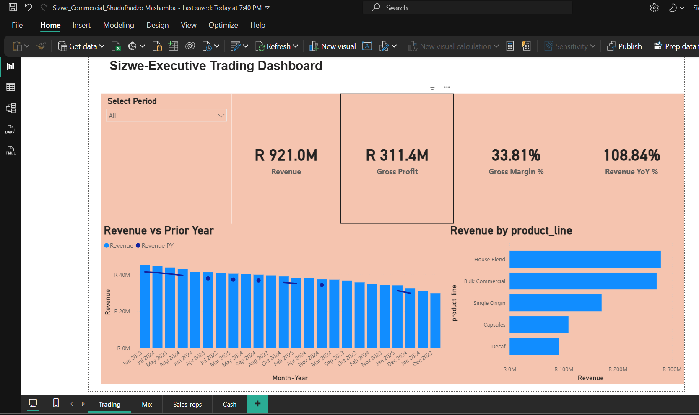
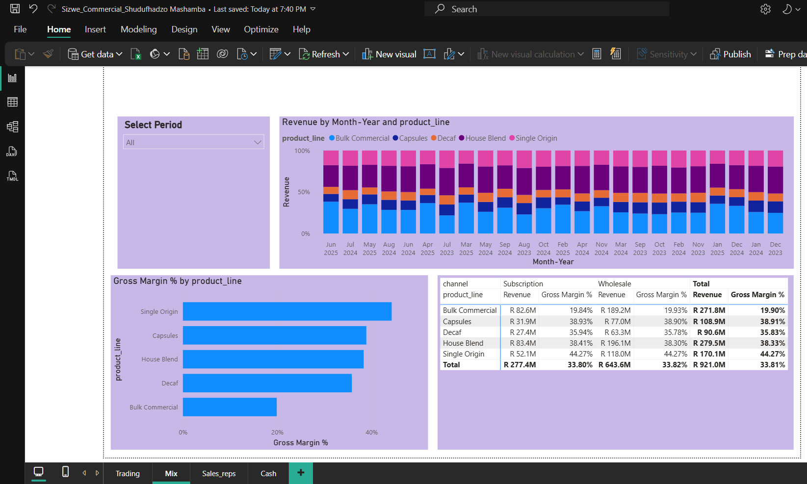
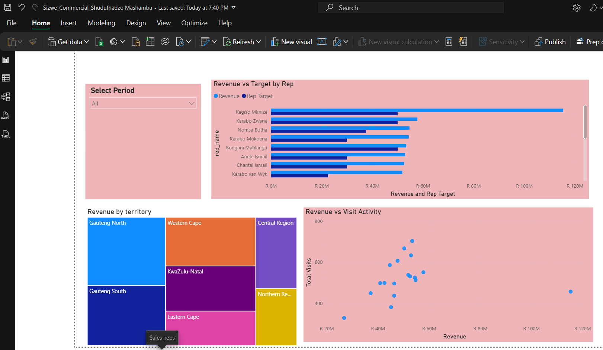
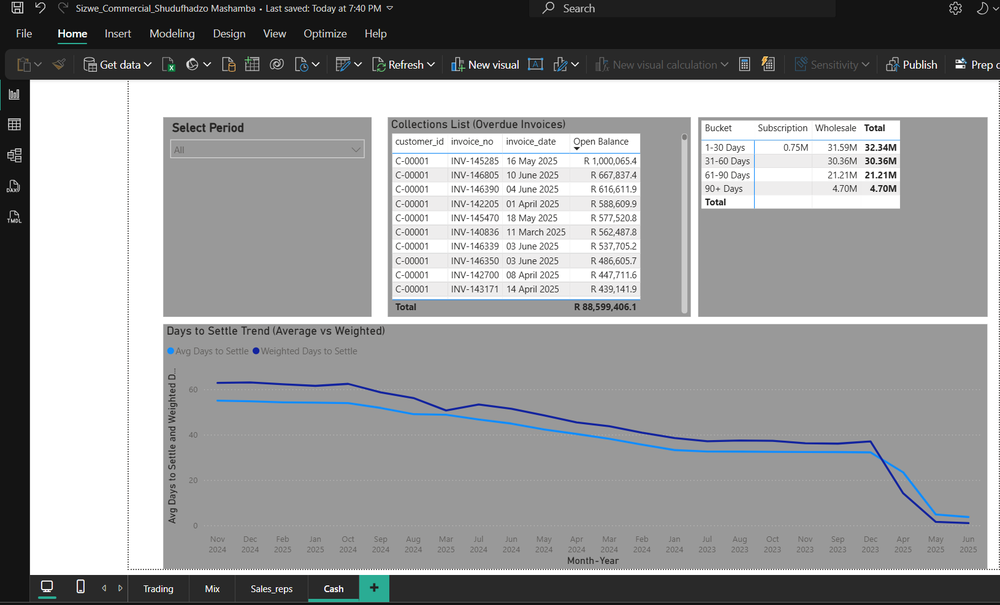

# Sizwe Coffee: Commercial & Receivables Analysis
*A 4-page Power BI dashboard that replaces a manual Excel reporting process to track trading performance and cash flow.*

## Business Problem
The Financial Director (Nomsa Dlamini) and National Sales Manager (Bongani Twala) needed a single Power BI report to replace a manual, two-day Excel reporting process. They wanted to see how the business is trading and where the cash is, filtering by Sizwe's July-June financial year. 

## Data
- **Source:** 8 CSV files (Creator Resources library)
- **Size:** ~168,000 sales line items, ~48,000 invoices.
- **Period:** 1 July 2023 to 30 June 2025 (FY2024 & FY2025).
- **Cleaning:** Used Power Query to set data types, rename fields, and build a custom continuous Date Dimension to handle Sizwe's July-June financial calendar.

## Tools and Skills
| Tool | Used for |
| --- | --- |
| **Power Query** | Data cleaning and building the custom DimDate table. |
| **Power BI / DAX** | Star Schema modeling, time intelligence (YoY, FYTD), dynamic ageing buckets. |
| **Data Visualization** | 4-page interactive dashboard with synced slicers, cards, matrices, and scatter plots. |

## Approach
1. **Data Modeling:** Built a Star Schema with 4 Dimension tables (`DimDate`, Customers, Products, Reps) and 5 Fact tables. 
2. **The Invoice-to-Order Problem:** Because there is no shared key between the AR Ledger and Sales Orders, I kept them as two separate fact tables connected via shared dimensions. This prevents duplicate rows and fan-out. 
3. **Validation:** Proved the model was correct by ensuring both Revenue and Invoiced Value hit the exact control total of **R921,000,020.82**.
4. **DAX:** Created measures for Trading, Time Intelligence, and Receivables. 
5. **Visualization:** Designed 4 pages (Trading, Mix, Sales Reps, Cash) formatted in millions (e.g., R 921.0M) for readability.

## Key Findings (The Memo)
- **What Moved:** Weighted days to settle dropped from ~60 days to ~35 days over the two years.
- **Why:** The data showed this was driven by a shift in product mix (selling more high-margin Single Origin and Capsules, and less slow-paying Bulk Commercial).
- **Which Number:** Weighted Days to Settle is the truthful metric to report to the FD. The simple average is skewed by high volumes of fast-paying small invoices, which hides the true cash exposure of large accounts.

## Recommendations
- **Collections Focus:** The collections list should prioritize the Wholesale channel, which holds a massive R30.36M sitting in the 31-60 day bucket.
- **Mix Strategy:** Continue pushing the sale of Single Origin and Capsules. They have a healthier margin (~44%) and improve cash flow.

## Limitations
- **Missing Key:** The source data lacks a key to link invoices directly to sales orders.
- **Distorted Period:** The final two months of the dataset (May–June 2025) show an artificially low days-to-settle metric because those invoices have not yet reached their settlement date. Handled on the report by noting the limitation.

## Visuals (Dashboard Preview)

*Page 1: How are we trading?*

*Page 2: What are we selling, and to whom?*

*Page 3: Who is selling it?*

*Page 4: Where is our cash?*

## Repository Structure
- `/Sizwe_Commercial_ShudufhadzoMashamba.pbix` - The Power BI file.
- `/Sizwe_Memo_ShudufhadzoMashamba.pdf` - 1-page executive memo to the FD.
- `/Sizwe_Model_Note_ShudufhadzoMashamba.pdf` - Data model documentation.
- `page1.png` to `page4.png` - Dashboard screenshots.

## Contact
**Shudufhadzo Mashamba** 
[Linkedin](https://www.linkedin.com/in/shudufhadzo-mashamba-7b24a232b/) · [Email](mailto:shudufhadzomashamba@gmail.com)
